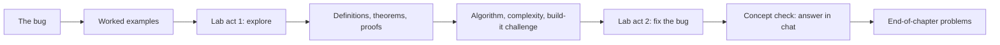

# The mail room: lessons in machine learning theory

A series of story-driven lessons on Shai Shalev-Shwartz and Shai Ben-David's *Understanding Machine Learning: From Theory to Algorithms* (Cambridge University Press, 2014). You are building the learner behind a company's mail filter. Every lesson opens on a bug your users notice, and ends when you fix it yourself in an interactive lab.

**Take the course: [www.estacouveflor.com/uml-lessons](https://www.estacouveflor.com/uml-lessons/)**. The index lists all 31 lessons with their status; start with [lesson 1, Learning needs a bias](https://www.estacouveflor.com/uml-lessons/01-learning-needs-a-bias/3-page/3-page.html).

Locally, open [index.html](index.html) in a browser: the pages are plain HTML files with `lesson.css` beside them and need no server.

Each lesson folder holds three representations of the same idea:

- `1-prose.md` and `1-sheet.md`: the lesson text, and the teacher's sheet (objective, terms, misconception, numbers, concept-check answers).
- `2-figures/`: the figures, one per concept, built from `figures.mjs` with the shared kit in `_kit/`.
- `3-page/`: the interactive page, built from the prose (`python3 build.py`).

There are no videos in this series.

`tokens.css` holds every colour, font, size and spacing value; see [docs/design-tokens.md](docs/design-tokens.md).

`series.md` holds the story world, the glossary every lesson shares, and the next bug. `TASKS.md` holds where the build stands.

`_kit/` holds the shared figure, page and lab code. `python3 _kit/index.py` rebuilds `index.html` from `series.md`.

## How each lesson works

## How they are made

With the `klay-learning-ladder` skill for Claude Code: [diagram-design](https://github.com/cathrynlavery/diagram-design) for diagrams and the iwrzwr visual archive for lab drawing code.

## License

Lesson text, figures and pages: [CC BY-NC 4.0](https://creativecommons.org/licenses/by-nc/4.0/). Code (labs, build scripts, figure builders): MIT. See [NOTICE](NOTICE).
