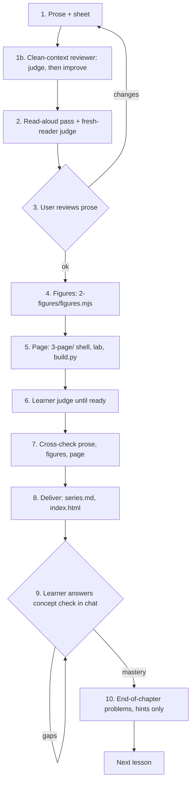

# Tasks

Where the course build stands, so work can resume in a new session on any day. Built with the `klay-learning-ladder` skill. Pages ship as files in this repo; never publish them as Artifacts. No videos in this series.

To resume: read **Session handoff** near the end first (every skill, tool, reference and rule the user gave), then continue from the first unticked box under **Status**. Work skipped on purpose (gates, reviews, judges) is collected under **Deferred (do later)** near the end: check it every session. Read `series.md` first (world, glossary, next bug) and update it last.

## To do next (in order)

Last updated 2026-11-20. Tick here and in **Status** as each lands; commit and push after every step (user: "commit and push as you go").

- [x] Split lesson 23: done 2026-11-21 (23a, 23b)
- [x] Split lesson 24 the same way (done 2026-11-21: 24a, 24b)
- [x] Repoint "lesson N" references in every prose and sheet to the right half for the split lessons 6, 7, 9, 10, 12, 13, 14, 15, 17, 21, 23, 24 (done 2026-11-21: 566 references changed by two agents, reviewed by the lead; provenance notes like "split from lesson N" kept)
- [ ] Book check and sheet resync (`docs/bookcheck-brief.md`) for unsplit lessons: done 2, 3, 4, 5, 8, 11, 16, 18, 19, 20, 22, 25, 26, 27 (2026-11-21); running 28, 29, 30, 31 (tick each with `python3 -I _kit/tick.py N 2 "note"`)
- [ ] Book check and sheet resync for every split half: 6a, 6b, 7a, 7b, 9a, 9b, 10a, 10b, 12a, 12b, 13a, 13b, 14a, 14b, 15a, 15b, 17a, 17b, 21a, 21b, then 23a, 23b, 24a, 24b
- [ ] After each edit: `python3 -I _kit/read.py <folder>` then `python3 -I _kit/index.py`, commit, push
- [ ] Figures (diagram-design) and labs (named iwrzwr studies) lesson by lesson from lesson 2: `2-figures/`, `3-page/`, `build.py`, `fit.mjs`, impeccable pass
- [x] Commit the `klay-learning-ladder` skill changes in ~/dotfiles: done 2026-11-21 as dd6d3e4 (KaTeX `math.mjs`, `shot.mjs`, `prose.py` fixes, phases and rules in SKILL.md, series template synced with the kit)
- [ ] Waiting on the user: review of the prose (live index), lesson 1 concept-check answers

## Source rule

Every claim about the book comes from the PDF, never from memory: `~/Library/Mobile Documents/3L68KQB4HG~com~readdle~CommonDocuments/Documents/understanding-machine-learning-theory-algorithms.pdf`. `book/map.md` gives each chapter's PDF pages, sections and exercises; `book/notation.md` gives the notation. Extract a range with `pdftotext -f FIRST -l LAST "<pdf>" -`. For each lesson, spawn parallel agents that each read one section range of the PDF and check the prose against it (step 2 below).

## Visual tools

All cloned locally under `~/.local/share/klay-learning-ladder/` (2026-11-20). Pick the tool by what the idea needs, and brief every figure or page builder with this table.

| Tool | Local path | Commit | Use it for |
|---|---|---|---|
| diagram-design | `diagram-design/` (skill in `skills/diagram-design/`) | 0cf73c3 | rule and relationship figures: charts, flows, geometric pictures, proof sketches (the default) |
| impeccable | `impeccable/` (skill in `skill/`, detector `skill/scripts/impeccable detect --json --scope type <page>`, then `--scope layout`) | b49177d | layout and typography passes on every page: Read mode, refinement of the series world (fonts and palette are committed); run the detector before and after |
| stack-diagram | `stack-diagram/` (skill in `skills/stack-diagram/SKILL.md`) | 5889b8e | system and pipeline pictures: the mail filter's architecture (users label, training sequence, learner, hypothesis, inbox), SGD and boosting loops drawn as systems, online learning as a service. Swap its JetBrains Mono for Geist Mono and its colors for `lesson.css` tokens. |
| iwrzwr visual archive | `iwrzwr-visual-archive/` | 794af32 | canvas drawing in labs (the kit's `lab.js` already adapts its Sample Hold Ladder study; MIT notice kept) |
| three.js | `threejs/` (sparse: `build`, `src`, `examples/jsm`, `manual`, `docs`) | 0245b6d | 3D only where the idea is 3D: halfspaces and margins in \(\mathbb R^3\) (ch. 9, 15), loss surfaces and gradient paths (ch. 12, 14), PCA projections (ch. 23), kernel feature maps lifting data (ch. 16). Load from a CDN with an exact version on the page; the clone is for reading examples and docs. |
| img2threejs | `img2threejs/` | 3e7099e | a physical object the learner must see in 3D (rare) |

## The learner's rules (from the syllabus prompt)

- Learner: experienced software engineer, learning ML theory from the ground up.
- Define every concept before using it. Full definitions, lemmas, theorems and step-by-step proofs, citing Appendices A, B and C where a step needs them.
- Connect each idea to an algorithm and its time and space cost.
- Notation of the book's Section 1.6: \(\mathcal X, \mathcal Y, \mathcal H\), \(S = (z_1, \dots, z_m) \sim \mathcal D^m\), \(\ell: \mathcal H \times Z \to \mathbb R_+\), \(L_{\mathcal D}(h)\), \(L_S(h)\), \(\|x\|\), \(O, \Theta, \tilde O\).
- Writing: clear and natural, a teacher talking. No robotic short-sentence style, no limited vocabulary. Easy to read, exact on concepts.
- Read every formula aloud for a learner meeting it for the first time (user, 2026-11-20: "everytime you show complex math, you have to explain as i'm learning it"). After each display formula, and any dense inline one: name every symbol and piece of notation in words (sets and set-builder braces, the colon as "such that", \(|\cdot|\), \([m]\), \(\sim\), \(\mathbb P\), \(\mathbb E\), subscripts, sums, sup, argmin, and so on), read it from the inside out, give the whole formula as one plain sentence in bold, work one tiny number from the story through it, and add a Python snippet that mirrors the formula term by term with its real output. A symbol explained in an earlier lesson still gets a one-line reminder the first time it appears in each lesson. Model: lesson 1, "The formal statements", the empirical and true risk.
- Concept before symbol (the klay-learning-ladder rule "every term defined before use", "show every idea working before you name it"): introduce each idea in words with a small number from the story before its formula appears, and never use a term, symbol or result, even inline, before it has been explained. The walkthrough after a formula reads the notation; it does not replace explaining the idea first.
- Make every class playful (user, 2026-11-20: "dont forget using the iwrzwr visual archive for lab drawing code and diagram-design to make classes playful"): every new concept gets a diagram-design figure (animated when the idea is a process, still under reduced motion), and every lab's drawing code adapts a named study from the iwrzwr visual archive (the sheet names the study, the code keeps its MIT notice). The learner should poke, drag and watch things move, not read static boxes.
- Never advance to the next unit until the learner has answered the concept check and confirmed mastery.

## How each lesson is made

Every lesson runs the same loop. Each lesson under **Status** has one checkbox per step; tick it, with the date, as soon as the step is done.

1. **Prose and sheet.** `1-prose.md` follows the five-step loop: the problem and motivation (opened as a bug in the mail room), formal definitions and proofs, the algorithm with pseudocode, complexity and a build-it challenge, a concept check of 2 or 3 questions. `1-sheet.md` holds terms, numbers, the lab spec and the concept-check answers. Every number is computed by a script, never guessed.
1b. **Clean-context reviewer** (user, 2026-11-20: "include a reviewer with clean context to judge and improve"). A fresh agent with only `docs/reviewer-brief.md` reads the prose as the learner, lists every term or symbol used before it is explained, every formula without a walkthrough, every proof gap and every wrong number, then fixes them in `1-prose.md`. Runs after the writer and the formula-walkthrough pass, before the user's review. The lead reruns `_kit/check_prose.py` before ticking.
2. **Gates.** Book check: parallel agents, one per section range of the PDF, mark every claim correct, not in the book, or wrong; `agent-voice speak` read-aloud pass per section; a fresh-reader subagent with no context; grep the key words for synonyms; grep for em dashes.
3. **Review stop.** Show the user the prose and the sheet. Nothing else gets built before this.
4. **Figures.** One per new concept, through diagram-design (never hand-drawn SVG), animated when the idea is a process, colors from `lesson.css`. `node _kit/build-figures.mjs NN-slug/2-figures/figures.mjs`, then `self_check.py` and `verify-geometry.py`; render once per theme.
5. **Page.** Lab drawing code adapted from a named iwrzwr visual archive study (list them in `~/.local/share/klay-learning-ladder/iwrzwr-visual-archive/`, pick the one whose motion matches the idea, keep the MIT notice); `3-page/` shell, `lab.html`, `lab-act2.html`, `lab.js`, `build.py`; `python3 3-page/build.py` exits 0.
6. **Learner judge.** A fresh agent walks the page in its own Chrome; fix and judge again until "ready".
7. **Verification.** Prose, figures and page teach one mental model; fix each mismatch at the earliest rung that has it.
8. **Delivery.** Mark the row in `series.md`, add glossary terms and the next bug, run `python3 _kit/index.py`.
9. **Concept check.** The learner answers in chat; critique rigorously; repeat until mastery is confirmed.
10. **End-of-chapter problems.** Pick 2 or 3 of the book's exercises (standard and starred once ready). Hints only, never the solution.

## Status

Tick a box the moment its step is done, and add the date. The first unticked box in the file is where work resumes.

### 0. Series setup

- [x] folder, `_kit/` (copied from dsp-oppenheim, video parts removed), `lesson.css`, README, NOTICE, `.gitignore`, `series.md`, `TASKS.md`, git init (2026-11-20)
- [x] `book/notation.md`: the book's notation with page numbers (2026-11-20)
- [x] `book/map.md`: page, section and exercise map of all 31 chapters; PDF page equals printed page throughout; 122 exercises (2026-11-20)
- [ ] first commit (when the user asks)
- [x] index lists all 31 lessons with status (user asked, 2026-11-20): titles from the series.md "Course plan" table, status and n/10 steps read from this file's boxes; rerun `python3 -I _kit/index.py` after every tick (2026-11-20)
- [x] (2026-11-20, uncommitted in ~/dotfiles) update the `klay-learning-ladder` skill with this session's findings (user asked, 2026-11-20): source from the PDF with parallel agents, TASKS.md with tick boxes, design tokens, impeccable passes, fonts and palette, layout rules, lab guarantee rule

### 1. Ch. 1, §1.1 to 1.4: what learning is, inductive bias, when ML is needed, kinds of learning, related fields

Folder: `01-learning-needs-a-bias/`

- [x] 1 prose and sheet (2026-11-20)
- [x] 2 gates (2026-11-20)
  - [x] fresh reader: random-pick learner, Proposition 2 independence spelled out, failure modes named, overclaims softened
  - [x] book check, three PDF agents (§1.1; §1.2 to 1.4; notation and §1.5 to 1.6): five sections rewritten to the book
  - [x] read-aloud pass (`read-aloud.log`): long sentences split
  - [x] key-word and em-dash greps clean
- [x] 3 review stop: user said go ahead; kept as one lesson, since the user set §1.1 to 1.4 as the unit (2026-11-20)
- [x] 4 figures: built by agent, checks rerun by lead, all 8 files pass self_check and verify-geometry (2026-11-20)
  - [x] messages (16-message grid)
  - [x] funnel (65,536 to 256 vs bias to 1)
  - [x] flip (the map φ pairing hypotheses)
  - [x] taxonomy (the book's four dimensions)
- [x] 5 page: built by agent, rebuilt by lead, `build.py` exits 0, 183 formulas, 6 slots (2026-11-20)
  - [x] lab act 1: memorizer vs one-feature learner, slider for m
  - [x] lab act 2 (budget 20 labels; one feature of ten 99% at 10 labels, 55 class 97% at 20): spammers change feature, pick class and label budget
  - [x] `python3 3-page/build.py` exits 0
- [x] 5b typography pass with impeccable (Read mode, refinement): measure 35em (about 70 characters), serif section headings with more space above than below, eyebrow replaced by a breadcrumb, curly quotes, themed selection and focus, canvas and figure text at least 12px. Scan: 26 type findings down to 4 (3 are the series' committed fonts, kept; 1 is the funnel phone figure, sent back to the figure builder) (2026-11-20)
- [x] 5c layout: one centred reading column, figures and labs break out evenly, tables and formulas fit at 360 px, no sideways scroll at 1280, 390 or 360 (2026-11-20)
- [x] 5d design tokens: `tokens.css` holds every colour, font, size, spacing, layout and motion value; `lesson.css`, `_kit/page.css`, `_kit/fig.css`, `_kit/lab.js` and the shell read only tokens; documented in `docs/design-tokens.md` (2026-11-20)
- [x] 5e fonts: Literata (reading), Rubik (headings and interface), IBM Plex Mono (code, data, figure labels), chosen by the user (2026-11-20)
- [x] 5f impeccable critique, dual-agent: 28/40 (Good); priority issues listed in the open items (2026-11-20)
- [x] 5g code highlighting (build-time, Python via the standard tokenizer, pseudocode by keyword, colours as tokens), Python snippets beside Propositions 1 and 2 with their real output, all book references removed from the page, figures and index (2026-11-20)
- [x] 6 learner judge: three judges, every finding addressed; final rebuild passes fit.mjs, no em dashes, no book references, no raw colours (2026-11-20) (judge 1 and 2: ready with polish. Judge 2 fixes: prose done 2026-11-20 (55-class hint corrected with its own bound and snippet, first-three class introduced, impostor defined before act 1, varphi, quotes, 4.6% scoped to the tiny world); lab fixes with the page builder (budget back to 20, fix must be earned, act 1 text, class text, Try another reset, inbox visual, subscripts); dark --input-soft strengthened. Judge 3 (2026-11-20): ready with polish; prose, figure and CSS fixes done by the lead (|X| instead of N in Proposition 1, lesson numbers in the taxonomy figure, captions centred, no smooth scroll under reduced motion); lab fixes with the page builder (feature 7 as a hypothetical, no fix credit for a lucky narrow class, budget 12, m = 3 wording, hide the answer before the prediction, reduced-motion success). No further judges without asking.)
- [x] 7 verification: judges 2 and 3 cross-checked every number across prose, snippets, labs and figures; lead reran all snippets (2026-11-20)
- [x] 8 delivery: series.md row and next bug, index.html rebuilt (2026-11-20)
- [ ] 9 concept check: mastery confirmed
- [ ] 10 end-of-chapter problems: Chapter 1 has none in the book; its problems come with lesson 2

### 2. Ch. 1 §1.6 notation and Chapter 1 problems; Ch. 2 a gentle start (statistical framework, ERM, overfitting, finite classes, realizability, i.i.d., union bound)

Folder: `02-a-gentle-start/`

- [x] 1 prose and sheet (8,134 words, all Python snippets run by the lead, no book references, 2026-11-20)
- [x] 2 gates: clean-context review; book check against the PDF (every definition and equation matches; one prose fix, the slack section's worst world) and sheet resync, 2026-11-20. Read-aloud and fresh reader not run (optional, CPU)
- [ ] 3 review stop: user approved the prose
- [ ] 4 figures
- [ ] 5 page
- [ ] 6 learner judge: ready
- [ ] 7 verification
- [ ] 8 delivery: series.md, index.html
- [ ] 9 concept check: mastery confirmed
- [ ] 10 end-of-chapter problems done

### 3. Ch. 3 a formal learning model (PAC, sample complexity, agnostic PAC, Bayes optimal, general losses)

Folder: `03-a-formal-learning-model/`

- [x] 1 prose and sheet (7,576 words, all Python snippets run by the lead, no book references, 2026-11-20)
- [x] 2 gates: clean-context review; book check against the PDF (own Bayes-optimality proof valid; δ vs 1 − δ naming conflict in the book confirmed, prose now says the name moves; realizability recap aligned with lesson 2; key words aligned) and sheet resync, 2026-11-20. Read-aloud and fresh reader not run (optional, CPU)
- [ ] 3 review stop: user approved the prose
- [ ] 4 figures
- [ ] 5 page
- [ ] 6 learner judge: ready
- [ ] 7 verification
- [ ] 8 delivery: series.md, index.html
- [ ] 9 concept check: mastery confirmed
- [ ] 10 end-of-chapter problems done

### 4. Ch. 4 uniform convergence (ε-representative samples, Hoeffding, discretization)

Folder: `04-uniform-convergence/`

- [x] 1 prose and sheet (7,479 words, 9 snippets run by the lead, the 9th is the build-it stub, no book references, 2026-11-20)
- [x] 2 gates: clean-context review; book check against the PDF (no book errors; five writer choices confirmed valid; one arithmetic fix 0.513; a slot sharing a line with text fixed by the lead) and sheet resync incl. LaTeX fixes, 2026-11-20. Read-aloud and fresh reader not run (optional, CPU)
- [ ] 3 review stop: user approved the prose
- [ ] 4 figures
- [ ] 5 page
- [ ] 6 learner judge: ready
- [ ] 7 verification
- [ ] 8 delivery: series.md, index.html
- [ ] 9 concept check: mastery confirmed
- [ ] 10 end-of-chapter problems done

### 5. Ch. 5 bias-complexity tradeoff (no free lunch, approximation vs estimation error)

Folder: `05-no-free-lunch/`

- [x] 1 prose and sheet (8,233 words, 8 snippets run by the lead, the failing fence is the build-it stub, no book references, 2026-11-20)
- [x] 2 gates: clean-context review; book check against the PDF (all statements correct; a book slip on p. 61 noted, 8 log(7|H|/6) should be 8 log(7|H|); one prose fix, the act-2 prediction question) and sheet resync, 2026-11-20. Read-aloud and fresh reader not run (optional, CPU)
- [ ] 3 review stop: user approved the prose
- [ ] 4 figures
- [ ] 5 page
- [ ] 6 learner judge: ready
- [ ] 7 verification
- [ ] 8 delivery: series.md, index.html
- [ ] 9 concept check: mastery confirmed
- [ ] 10 end-of-chapter problems done

### 6a. The VC dimension

Folder: `06a-vc-dimension/`

- [x] 1 prose and sheet (split from lesson 6 on 2026-11-20; original in `_archive/06-vc-dimension`; clean-context review carried over)
- [ ] 2 gates: book check (PDF agents), sheet resync, greps
- [ ] 3 review stop: user approved the prose
- [ ] 4 figures
- [ ] 5 page
- [ ] 6 learner judge: ready
- [ ] 7 verification
- [ ] 8 delivery: series.md, index.html
- [ ] 9 concept check: mastery confirmed
- [ ] 10 end-of-chapter problems done

### 6b. The growth function

Folder: `06b-growth-function/`

- [x] 1 prose and sheet (split from lesson 6 on 2026-11-20; original in `_archive/06-vc-dimension`; clean-context review carried over)
- [ ] 2 gates: book check (PDF agents), sheet resync, greps
- [ ] 3 review stop: user approved the prose
- [ ] 4 figures
- [ ] 5 page
- [ ] 6 learner judge: ready
- [ ] 7 verification
- [ ] 8 delivery: series.md, index.html
- [ ] 9 concept check: mastery confirmed
- [ ] 10 end-of-chapter problems done

### 7a. Nonuniform learnability

Folder: `07a-nonuniform-learnability/`

- [x] 1 prose and sheet (split from lesson 7 on 2026-11-20; original in `_archive/07-nonuniform-learnability`; clean-context review carried over)
- [ ] 2 gates: book check (PDF agents), sheet resync, greps
- [ ] 3 review stop: user approved the prose
- [ ] 4 figures
- [ ] 5 page
- [ ] 6 learner judge: ready
- [ ] 7 verification
- [ ] 8 delivery: series.md, index.html
- [ ] 9 concept check: mastery confirmed
- [ ] 10 end-of-chapter problems done

### 7b. Description length and Occam's razor

Folder: `07b-description-length/`

- [x] 1 prose and sheet (split from lesson 7 on 2026-11-20; original in `_archive/07-nonuniform-learnability`; clean-context review carried over)
- [ ] 2 gates: book check (PDF agents), sheet resync, greps
- [ ] 3 review stop: user approved the prose
- [ ] 4 figures
- [ ] 5 page
- [ ] 6 learner judge: ready
- [ ] 7 verification
- [ ] 8 delivery: series.md, index.html
- [ ] 9 concept check: mastery confirmed
- [ ] 10 end-of-chapter problems done

### 8. Ch. 8 the runtime of learning

Folder: `08-runtime-of-learning/`

- [x] 1 prose and sheet (10,310 words, 12 snippets plus 4 build-it stubs run by the lead, no book references; opening aligned with lesson 7's cliffhanger (1.55e28 lists at size 22), rechecked by the lead, 2026-11-20)
- [x] 2 gates: clean-context review; book check (two book slips confirmed: conjunction bound fails at small n, 3-CNF bound wrong as a bound; two prose fixes) and sheet resync, 2026-11-20
- [ ] 3 review stop: user approved the prose
- [ ] 4 figures
- [ ] 5 page
- [ ] 6 learner judge: ready
- [ ] 7 verification
- [ ] 8 delivery: series.md, index.html
- [ ] 9 concept check: mastery confirmed
- [ ] 10 end-of-chapter problems done

### 9a. Halfspaces and the Perceptron

Folder: `09a-halfspaces-perceptron/`

- [x] 1 prose and sheet (split from lesson 9 on 2026-11-20; original in `_archive/09-linear-predictors`; clean-context review carried over)
- [ ] 2 gates: book check (PDF agents), sheet resync, greps
- [ ] 3 review stop: user approved the prose
- [ ] 4 figures
- [ ] 5 page
- [ ] 6 learner judge: ready
- [ ] 7 verification
- [ ] 8 delivery: series.md, index.html
- [ ] 9 concept check: mastery confirmed
- [ ] 10 end-of-chapter problems done

### 9b. Linear and logistic regression

Folder: `09b-linear-regression/`

- [x] 1 prose and sheet (split from lesson 9 on 2026-11-20; original in `_archive/09-linear-predictors`; clean-context review carried over)
- [ ] 2 gates: book check (PDF agents), sheet resync, greps
- [ ] 3 review stop: user approved the prose
- [ ] 4 figures
- [ ] 5 page
- [ ] 6 learner judge: ready
- [ ] 7 verification
- [ ] 8 delivery: series.md, index.html
- [ ] 9 concept check: mastery confirmed
- [ ] 10 end-of-chapter problems done

### 10a. AdaBoost

Folder: `10a-adaboost/`

- [x] 1 prose and sheet (split from lesson 10 on 2026-11-20; original in `_archive/10-boosting`; clean-context review carried over)
- [ ] 2 gates: book check (PDF agents), sheet resync, greps
- [ ] 3 review stop: user approved the prose
- [ ] 4 figures
- [ ] 5 page
- [ ] 6 learner judge: ready
- [ ] 7 verification
- [ ] 8 delivery: series.md, index.html
- [ ] 9 concept check: mastery confirmed
- [ ] 10 end-of-chapter problems done

### 10b. Boosting and fresh mail

Folder: `10b-boosting-generalization/`

- [x] 1 prose and sheet (split from lesson 10 on 2026-11-20; original in `_archive/10-boosting`; clean-context review carried over)
- [ ] 2 gates: book check (PDF agents), sheet resync, greps
- [ ] 3 review stop: user approved the prose
- [ ] 4 figures
- [ ] 5 page
- [ ] 6 learner judge: ready
- [ ] 7 verification
- [ ] 8 delivery: series.md, index.html
- [ ] 9 concept check: mastery confirmed
- [ ] 10 end-of-chapter problems done

### 11. Ch. 11 model selection and validation

Folder: `11-model-selection/`

- [x] 1 prose and sheet (8,580 words, 9 snippets plus the build-it stub run by the lead, no book references; check its boosting terms against lesson 10 when it lands, 2026-11-20)
- [x] 2 gates: writer's PDF self-check, scripts and greps done; book-check agents, read-aloud and fresh reader deferred (book check: all matches pp. 144 to 155, writer choices valid; one prose fix (10a to 10b); sheet resynced; 2026-11-21)
- [ ] 3 review stop: user approved the prose
- [ ] 4 figures
- [ ] 5 page
- [ ] 6 learner judge: ready
- [ ] 7 verification
- [ ] 8 delivery: series.md, index.html
- [ ] 9 concept check: mastery confirmed
- [ ] 10 end-of-chapter problems done

### 12a. Convexity

Folder: `12a-convexity/`

- [x] 1 prose and sheet (split from lesson 12 on 2026-11-20; original in `_archive/12-convex-learning`; clean-context review carried over)
- [ ] 2 gates: book check (PDF agents), sheet resync, greps
- [ ] 3 review stop: user approved the prose
- [ ] 4 figures
- [ ] 5 page
- [ ] 6 learner judge: ready
- [ ] 7 verification
- [ ] 8 delivery: series.md, index.html
- [ ] 9 concept check: mastery confirmed
- [ ] 10 end-of-chapter problems done

### 12b. Convex learnability and surrogates

Folder: `12b-convex-learnability/`

- [x] 1 prose and sheet (split from lesson 12 on 2026-11-20; original in `_archive/12-convex-learning`; clean-context review carried over)
- [ ] 2 gates: book check (PDF agents), sheet resync, greps
- [ ] 3 review stop: user approved the prose
- [ ] 4 figures
- [ ] 5 page
- [ ] 6 learner judge: ready
- [ ] 7 verification
- [ ] 8 delivery: series.md, index.html
- [ ] 9 concept check: mastery confirmed
- [ ] 10 end-of-chapter problems done

### 13a. Regularization and stability

Folder: `13a-stability/`

- [x] 1 prose and sheet (split from lesson 13 on 2026-11-20; original in `_archive/13-regularization-stability`; clean-context review carried over)
- [ ] 2 gates: book check (PDF agents), sheet resync, greps
- [ ] 3 review stop: user approved the prose
- [ ] 4 figures
- [ ] 5 page
- [ ] 6 learner judge: ready
- [ ] 7 verification
- [ ] 8 delivery: series.md, index.html
- [ ] 9 concept check: mastery confirmed
- [ ] 10 end-of-chapter problems done

### 13b. Strong convexity and the fitting-stability tradeoff

Folder: `13b-strong-convexity/`

- [x] 1 prose and sheet (split from lesson 13 on 2026-11-20; original in `_archive/13-regularization-stability`; clean-context review carried over)
- [ ] 2 gates: book check (PDF agents), sheet resync, greps
- [ ] 3 review stop: user approved the prose
- [ ] 4 figures
- [ ] 5 page
- [ ] 6 learner judge: ready
- [ ] 7 verification
- [ ] 8 delivery: series.md, index.html
- [ ] 9 concept check: mastery confirmed
- [ ] 10 end-of-chapter problems done

### 14a. From gradient descent to SGD

Folder: `14a-gradient-descent/`

- [x] 1 prose and sheet (split from lesson 14 on 2026-11-20; original in `_archive/14-stochastic-gradient-descent`; clean-context review carried over)
- [ ] 2 gates: book check (PDF agents), sheet resync, greps
- [ ] 3 review stop: user approved the prose
- [ ] 4 figures
- [ ] 5 page
- [ ] 6 learner judge: ready
- [ ] 7 verification
- [ ] 8 delivery: series.md, index.html
- [ ] 9 concept check: mastery confirmed
- [ ] 10 end-of-chapter problems done

### 14b. SGD variants and faster rates

Folder: `14b-sgd-variants/`

- [x] 1 prose and sheet (split from lesson 14 on 2026-11-20; original in `_archive/14-stochastic-gradient-descent`; clean-context review carried over)
- [ ] 2 gates: book check (PDF agents), sheet resync, greps
- [ ] 3 review stop: user approved the prose
- [ ] 4 figures
- [ ] 5 page
- [ ] 6 learner judge: ready
- [ ] 7 verification
- [ ] 8 delivery: series.md, index.html
- [ ] 9 concept check: mastery confirmed
- [ ] 10 end-of-chapter problems done

### 15a. Hard-SVM and the margin

Folder: `15a-hard-svm/`

- [x] 1 prose and sheet (split from lesson 15 on 2026-11-20; original in `_archive/15-support-vector-machines`; clean-context review carried over)
- [ ] 2 gates: book check (PDF agents), sheet resync, greps
- [ ] 3 review stop: user approved the prose
- [ ] 4 figures
- [ ] 5 page
- [ ] 6 learner judge: ready
- [ ] 7 verification
- [ ] 8 delivery: series.md, index.html
- [ ] 9 concept check: mastery confirmed
- [ ] 10 end-of-chapter problems done

### 15b. Soft-SVM and support vectors

Folder: `15b-soft-svm/`

- [x] 1 prose and sheet (split from lesson 15 on 2026-11-20; original in `_archive/15-support-vector-machines`; clean-context review carried over)
- [ ] 2 gates: book check (PDF agents), sheet resync, greps
- [ ] 3 review stop: user approved the prose
- [ ] 4 figures
- [ ] 5 page
- [ ] 6 learner judge: ready
- [ ] 7 verification
- [ ] 8 delivery: series.md, index.html
- [ ] 9 concept check: mastery confirmed
- [ ] 10 end-of-chapter problems done

### 16. Ch. 16 kernel methods

Folder: `16-kernel-methods/`

- [x] 1 prose and sheet (about 10,100 words with code, 12 snippets run by the lead; the failing fence is the build-it stub; no book references, 2026-11-20). Writer's claims to verify: exercise 1's "norm 1, margin 1" looks unattainable with 0/1 substring features (prose uses norm 2); filled gaps in the kernel characterization proof. Align recaps with lessons 12 to 15
- [x] 2 gates: writer's PDF self-check, scripts and greps done; book-check agents, read-aloud and fresh reader deferred (book check: exercise 1 margin and characterization-proof gaps confirmed, two new book slips noted; two prose fixes; sheet resynced; 2026-11-21)
- [ ] 3 review stop: user approved the prose
- [ ] 4 figures
- [ ] 5 page
- [ ] 6 learner judge: ready
- [ ] 7 verification
- [ ] 8 delivery: series.md, index.html
- [ ] 9 concept check: mastery confirmed
- [ ] 10 end-of-chapter problems done

### 17a. Multiclass and structured prediction

Folder: `17a-multiclass/`

- [x] 1 prose and sheet (split from lesson 17 on 2026-11-20; original in `_archive/17-multiclass-ranking`; clean-context review carried over)
- [ ] 2 gates: book check (PDF agents), sheet resync, greps
- [ ] 3 review stop: user approved the prose
- [ ] 4 figures
- [ ] 5 page
- [ ] 6 learner judge: ready
- [ ] 7 verification
- [ ] 8 delivery: series.md, index.html
- [ ] 9 concept check: mastery confirmed
- [ ] 10 end-of-chapter problems done

### 17b. Ranking

Folder: `17b-ranking/`

- [x] 1 prose and sheet (split from lesson 17 on 2026-11-20; original in `_archive/17-multiclass-ranking`; clean-context review carried over)
- [ ] 2 gates: book check (PDF agents), sheet resync, greps
- [ ] 3 review stop: user approved the prose
- [ ] 4 figures
- [ ] 5 page
- [ ] 6 learner judge: ready
- [ ] 7 verification
- [ ] 8 delivery: series.md, index.html
- [ ] 9 concept check: mastery confirmed
- [ ] 10 end-of-chapter problems done

### 18. Ch. 18 decision trees

Folder: `18-decision-trees/`

- [x] 1 prose and sheet (about 9,700 words with code, 10 snippets run by the lead; the 2 failing fences are build-it stubs, by design; no book references, 2026-11-20). Writer's claims to verify: the book's threshold indexing is off by one, and its ID3 pseudocode has a check that never triggers; opening still to align with lesson 17's cliffhanger
- [x] 2 gates: writer's PDF self-check, scripts and greps done; book-check agents, read-aloud and fresh reader deferred (book check: threshold off-by-one, dead ID3 check and missing ceiling confirmed; three prose fixes; sheet resynced; 2026-11-21)
- [ ] 3 review stop: user approved the prose
- [ ] 4 figures
- [ ] 5 page
- [ ] 6 learner judge: ready
- [ ] 7 verification
- [ ] 8 delivery: series.md, index.html
- [ ] 9 concept check: mastery confirmed
- [ ] 10 end-of-chapter problems done

### 19. Ch. 19 nearest neighbor

Folder: `19-nearest-neighbor/`

- [x] 1 prose and sheet (about 9,050 words with code, 13 snippets run by the lead; the failing fence is the build-it stub; no book references, 2026-11-20). Writer's claims to verify: the 1-NN proof's parameter choice made rigorous; a possible book error (exercise 4 gives 2k, not k, unless m^{1/(d+1)}/2 is whole); the weighted-average formula looks like a typo. Align opening with lesson 18's cliffhanger
- [x] 2 gates: writer's PDF self-check, scripts and greps done; book-check agents, read-aloud and fresh reader deferred (book check: 1-NN parameter and exercise 4 constant confirmed; Θ now introduced in the lesson; sheet resynced; 2026-11-21)
- [ ] 3 review stop: user approved the prose
- [ ] 4 figures
- [ ] 5 page
- [ ] 6 learner judge: ready
- [ ] 7 verification
- [ ] 8 delivery: series.md, index.html
- [ ] 9 concept check: mastery confirmed
- [ ] 10 end-of-chapter problems done

### 20. Ch. 20 neural networks

Folder: `20-neural-networks/`

- [x] 1 prose and sheet (about 13,000 words with code, 20 snippets run by the lead; the failing fence is the build-it stub; no book references; written with the walkthrough and concept-before-symbol rules; 2026-11-20). Long: the sheet lists what could move to a 20b. Writer's claims to verify: a sharper exponential-size bound than the book's; own explicit VC constant; constant neurons output 1
- [x] 2 gates: writer's PDF self-check, scripts and greps done; book-check agents, read-aloud and fresh reader deferred (book check: three writer choices valid, two prose overclaims fixed; sheet resynced; 2026-11-21)
- [ ] 3 review stop: user approved the prose
- [ ] 4 figures
- [ ] 5 page
- [ ] 6 learner judge: ready
- [ ] 7 verification
- [ ] 8 delivery: series.md, index.html
- [ ] 9 concept check: mastery confirmed
- [ ] 10 end-of-chapter problems done

### 21a. Online mistake bounds

Folder: `21a-online-mistake-bounds/`

- [x] 1 prose and sheet (split from lesson 21 on 2026-11-20; original in `_archive/21-online-learning`; clean-context review carried over)
- [ ] 2 gates: book check (PDF agents), sheet resync, greps
- [ ] 3 review stop: user approved the prose
- [ ] 4 figures
- [ ] 5 page
- [ ] 6 learner judge: ready
- [ ] 7 verification
- [ ] 8 delivery: series.md, index.html
- [ ] 9 concept check: mastery confirmed
- [ ] 10 end-of-chapter problems done

### 21b. Online regret

Folder: `21b-online-regret/`

- [x] 1 prose and sheet (split from lesson 21 on 2026-11-20; original in `_archive/21-online-learning`; clean-context review carried over)
- [ ] 2 gates: book check (PDF agents), sheet resync, greps
- [ ] 3 review stop: user approved the prose
- [ ] 4 figures
- [ ] 5 page
- [ ] 6 learner judge: ready
- [ ] 7 verification
- [ ] 8 delivery: series.md, index.html
- [ ] 9 concept check: mastery confirmed
- [ ] 10 end-of-chapter problems done

### 22. Ch. 22 clustering

Folder: `22-clustering/`

- [x] 1 prose and sheet (about 13,400 words with code, 13 snippets run by the lead; the failing fences are build-it stubs; no book references; written with the walkthrough and concept-before-symbol rules; 2026-11-20). Writer's claims to verify: the book contradicts itself on whether k-means satisfies consistency (prose keeps 'fails', softened; no small counterexample found, the lab must not claim one); own termination proof and tie rules. Align opening with lesson 21's cliffhanger
- [x] 2 gates: writer's PDF self-check, scripts and greps done; book-check agents, read-aloud and fresh reader deferred (book check: k-means consistency contradiction and two book slips confirmed; one NP-hardness overclaim fixed; sheet resynced; 2026-11-21)
- [ ] 3 review stop: user approved the prose
- [ ] 4 figures
- [ ] 5 page
- [ ] 6 learner judge: ready
- [ ] 7 verification
- [ ] 8 delivery: series.md, index.html
- [ ] 9 concept check: mastery confirmed
- [ ] 10 end-of-chapter problems done

### 23a. PCA and random projections

Folder: `23a-pca-random-projections/`

- [x] 1 prose and sheet (split from lesson 23 on 2026-11-21; original in `_archive/23-dimensionality-reduction`; clean-context review carried over)
- [ ] 2 gates: book check (PDF agents), sheet resync, greps
- [ ] 3 review stop: user approved the prose
- [ ] 4 figures
- [ ] 5 page
- [ ] 6 learner judge: ready
- [ ] 7 verification
- [ ] 8 delivery: series.md, index.html
- [ ] 9 concept check: mastery confirmed
- [ ] 10 end-of-chapter problems done

### 23b. Compressed sensing

Folder: `23b-compressed-sensing/`

- [x] 1 prose and sheet (split from lesson 23 on 2026-11-21; original in `_archive/23-dimensionality-reduction`; clean-context review carried over)
- [ ] 2 gates: book check (PDF agents), sheet resync, greps
- [ ] 3 review stop: user approved the prose
- [ ] 4 figures
- [ ] 5 page
- [ ] 6 learner judge: ready
- [ ] 7 verification
- [ ] 8 delivery: series.md, index.html
- [ ] 9 concept check: mastery confirmed
- [ ] 10 end-of-chapter problems done

### 24a. Generative models and maximum likelihood

Folder: `24a-maximum-likelihood/`

- [x] 1 prose and sheet (split from lesson 24 on 2026-11-21; original in `_archive/24-generative-models`; clean-context review carried over)
- [ ] 2 gates: book check (PDF agents), sheet resync, greps
- [ ] 3 review stop: user approved the prose
- [ ] 4 figures
- [ ] 5 page
- [ ] 6 learner judge: ready
- [ ] 7 verification
- [ ] 8 delivery: series.md, index.html
- [ ] 9 concept check: mastery confirmed
- [ ] 10 end-of-chapter problems done

### 24b. Discriminant analysis and EM

Folder: `24b-discriminant-em/`

- [x] 1 prose and sheet (split from lesson 24 on 2026-11-21; original in `_archive/24-generative-models`; clean-context review carried over)
- [ ] 2 gates: book check (PDF agents), sheet resync, greps
- [ ] 3 review stop: user approved the prose
- [ ] 4 figures
- [ ] 5 page
- [ ] 6 learner judge: ready
- [ ] 7 verification
- [ ] 8 delivery: series.md, index.html
- [ ] 9 concept check: mastery confirmed
- [ ] 10 end-of-chapter problems done

### 25. Ch. 25 feature selection and generation

Folder: `25-feature-selection/`

- [x] 1 prose and sheet (about 16,100 words with code, 24 snippets run by the lead; the failing fence is the build-it stub; no book references; written with both rules; 2026-11-20). Writer's claims to verify, six book slips: ridge 2λm should be λm; OMP update divides by ‖u‖² not ‖u‖; clipping max should be min; R^m should be R; '≥ γ/2' weaker than the 2γ that follows; 10^8 should be about 4×10^8. Align recaps of ridge, naive Bayes, k-means, PCA and neural networks with lessons 13 and 20 to 24 (now drafted)
- [x] 2 gates: writer's PDF self-check, scripts and greps done; book-check agents, read-aloud and fresh reader deferred (book check: prose needed no change; five of six book slips confirmed, one a loose but true bound; sheet resynced; 2026-11-21)
- [ ] 3 review stop: user approved the prose
- [ ] 4 figures
- [ ] 5 page
- [ ] 6 learner judge: ready
- [ ] 7 verification
- [ ] 8 delivery: series.md, index.html
- [ ] 9 concept check: mastery confirmed
- [ ] 10 end-of-chapter problems done

### 26. Ch. 26 Rademacher complexities

Folder: `26-rademacher-complexity/`

- [x] 1 prose and sheet (about 13,000 words with code, 17 snippets run by the lead; the failing fence is the build-it stub; no book references; written with both rules; 2026-11-20). No exercises in the chapter: three problems written for the lesson. Writer's claims to verify: own McDiarmid proof; sharper constants than the book states (3c and 4c; hard-SVM bound without the (1+R‖w*‖) factor); learned-norm bound a factor 2 larger than the book's statement plus a ‖w‖ ≥ 2 condition. Check its assumptions that lesson 25 covers the ℓ1 penalty (it does) and lesson 20 two-layer networks
- [x] 2 gates: writer's PDF self-check, scripts and greps done; book-check agents, read-aloud and fresh reader deferred (book check: prose needed no change; three book slips confirmed, sharper constants valid; sheet resynced; 2026-11-21)
- [ ] 3 review stop: user approved the prose
- [ ] 4 figures
- [ ] 5 page
- [ ] 6 learner judge: ready
- [ ] 7 verification
- [ ] 8 delivery: series.md, index.html
- [ ] 9 concept check: mastery confirmed
- [ ] 10 end-of-chapter problems done

### 27. Ch. 27 covering numbers

Folder: `27-covering-numbers/`

- [x] 1 prose and sheet (about 9,400 words, 13 snippets run by the lead; the failing fence is the build-it stub; no book references; written with both rules; 2026-11-20). No exercises in the chapter: three problems written for the lesson. Writer's claims to verify: a lemma's inequality reversed for stretch factors above 1; an example's grid count off; Massart reproved in uncentered form. Align terms with lesson 26 when it lands
- [x] 2 gates: writer's PDF self-check, scripts and greps done; book-check agents, read-aloud and fresh reader deferred (book check: prose needed no change; lemma 27.2 direction and example 27.1 grid count confirmed as slips; a wrong lab gap fixed in the sheet; 2026-11-21)
- [ ] 3 review stop: user approved the prose
- [ ] 4 figures
- [ ] 5 page
- [ ] 6 learner judge: ready
- [ ] 7 verification
- [ ] 8 delivery: series.md, index.html
- [ ] 9 concept check: mastery confirmed
- [ ] 10 end-of-chapter problems done

### 28. Ch. 28 proof of the fundamental theorem

Folder: `28-fundamental-theorem-proof/`

- [x] 1 prose and sheet (about 12,600 words with code, 18 snippets run by the lead; the failing fence is the build-it stub; no book references; written with both rules; 2026-11-20). No exercises in the chapter: three problems written for the lesson. Writer's claims to verify: a lemma (A.2) needs b > 0, which fails for d ≥ 3, so a tangent-line lemma is used; the normal-tail lemma replaced by a Cauchy–Schwarz overlap lemma, fixing a tie mistake for even m; the dimension floor's proved constant is d/(512ε²) while the section heading says 8d/ε² (book/map.md quotes the heading verbatim, which is right as a map); the ε-net Chernoff chain is broken, Chebyshev used instead
- [x] 2 gates: writer's PDF self-check, scripts and greps done; book-check agents, read-aloud and fresh reader deferred (book-checked 2026-11-21; B.11 tie, p.395 typos, dimension floor, eps-net chain slips in sheet)
- [ ] 3 review stop: user approved the prose
- [ ] 4 figures
- [ ] 5 page
- [ ] 6 learner judge: ready
- [ ] 7 verification
- [ ] 8 delivery: series.md, index.html
- [ ] 9 concept check: mastery confirmed
- [ ] 10 end-of-chapter problems done

### 29. Ch. 29 multiclass learnability

Folder: `29-multiclass-learnability/`

- [x] 1 prose and sheet (about 13,300 words with code, 16 snippets run by the lead; the failing fence is the build-it stub; no book references; written with both rules; 2026-11-20). Writer's claims to verify: the one-versus-all counting step uses |C|^d, false for d = 1, replaced by (|C|+1)^d with kd ≥ 4; the bad-ERM failure holds with probability 1 under the book's distribution, so the Chernoff step is not needed. Whether the conjecture the chapter mentions has since been resolved was not checked. Align its recaps of the binary lower bounds with lesson 28 (now drafted)
- [x] 2 gates: writer's PDF self-check, scripts and greps done; book-check agents, read-aloud and fresh reader deferred (book-checked 2026-11-21; Lemma 29.5 and bad-ERM wording slips in sheet)
- [ ] 3 review stop: user approved the prose
- [ ] 4 figures
- [ ] 5 page
- [ ] 6 learner judge: ready
- [ ] 7 verification
- [ ] 8 delivery: series.md, index.html
- [ ] 9 concept check: mastery confirmed
- [ ] 10 end-of-chapter problems done

### 30. Ch. 30 compression bounds

Folder: `30-compression-bounds/`

- [x] 1 prose and sheet (about 13,700 words with code, 18 snippets run by the lead; the failing fence is the build-it stub; no book references; written with both rules; 2026-11-20). No exercises in the chapter: three problems written for the lesson. Writer's own: proof of a Bernstein lemma part the book skips, Carathéodory with proof, Gilbert's algorithm, the Moran–Yehudayoff 2016 result (verify the citation)
- [x] 2 gates: writer's PDF self-check, scripts and greps done; book-check agents, read-aloud and fresh reader deferred (book-checked 2026-11-21; Lemma B.10 part 1 slip recorded in sheet)
- [ ] 3 review stop: user approved the prose
- [ ] 4 figures
- [ ] 5 page
- [ ] 6 learner judge: ready
- [ ] 7 verification
- [ ] 8 delivery: series.md, index.html
- [ ] 9 concept check: mastery confirmed
- [ ] 10 end-of-chapter problems done

### 31. Ch. 31 PAC-Bayes

Folder: `31-pac-bayes/`

- [x] 1 prose and sheet (about 11,600 words with code, 18 snippets run by the lead; the failing fence is the build-it stub; no book references; written with both rules; the series' closing look-back; 2026-11-20). Writer's claims to verify: the book's proof uses a one-sided Hoeffding tail for Δ², run on Δ⁺ instead; Equation 31.2's last '=' should be '≤'. Recheck the look-back paragraph on lessons 26 to 30 (now drafted)
- [x] 2 gates: writer's PDF self-check, scripts and greps done; book-check agents, read-aloud and fresh reader deferred (book-checked 2026-11-21; Exercise 1 counterexample and 31.2 slips in sheet)
- [ ] 3 review stop: user approved the prose
- [ ] 4 figures
- [ ] 5 page
- [ ] 6 learner judge: ready
- [ ] 7 verification
- [ ] 8 delivery: series.md, index.html
- [ ] 9 concept check: mastery confirmed
- [ ] 10 end-of-chapter problems done

Appendices A (technical lemmas), B (measure concentration) and C (linear algebra) are not lessons of their own: each lesson cites and proves what it needs from them, the first time it needs it.

Lesson numbers match chapter numbers. A chapter too big for one lesson splits into `NNa-`, `NNb-` folders; record the split here.

## Session handoff (read this after any context reset)

Everything the user gave this series, so no session loses it:

- **Skills to load:** `klay-learning-ladder` (this series' method; skill folder `~/.claude/skills/klay-learning-ladder`, symlinked from `~/dotfiles/claude/skills/klay-learning-ladder`, changed this session and not yet committed). `artifact-design` only for the page contract. Never `klay-artifact-style` on lessons.
- **Source:** the book PDF (path in Source rule above), read with `pdftotext`; `book/map.md` (chapter pages, sections, all 122 exercises) and `book/notation.md`. Lessons never cite the book.
- **Visual tools, all cloned in `~/.local/share/klay-learning-ladder/` and pinned in the skill's `scripts/ensure.sh`:** diagram-design, stack-diagram (caru-ini), iwrzwr visual archive, three.js, impeccable (pbakaus; layout, typography and critique playbooks, `skill/scripts/impeccable detect`), anatomy, img2threejs.
- **Look:** `tokens.css` (single source of colours, fonts, sizes, spacing, layout), documented in `docs/design-tokens.md`. Fonts chosen by the user: Literata (reading) and Rubik (headings and interface), with IBM Plex Mono for code. Warm off-white palette, blue input, amber accent and wrong values, green success only. Avoid anything that looks like Claude's own interface.
- **Writing rules:** natural teacher voice, easy to read, no robotic style; every term defined first; rigorous proofs; Python snippets beside hard math (the user learns math through code), run and pasted; code lines at most 66 characters; `\varepsilon` for epsilon; no em dashes; curly quotes; no book references in anything the learner sees.
- **Process rules:** tick boxes here with dates as work is done; spawn writers freely; ask before judges, browsers or agent-voice (CPU); the user answers concept checks in chat; no videos in this series; commit only when the user asks.
- **Checks:** `python3 -I _kit/check_prose.py <lesson-folder>` (snippets run, book references, long code lines, em dashes, `\epsilon`), `node ~/.claude/skills/klay-learning-ladder/scripts/fit.mjs <page>` (no sideways scroll), the impeccable detector.
- **Writer brief:** `docs/writer-brief.md` with `{N}`, `{PREV}`, `{CHAPTER}`, `{STORY}`, `{FOLDER}` to fill; each lesson's story is fixed by the previous lesson's cliffhanger.
- **Memories saved:** lessons from the PDF, not memory; writers yes, judges no; the user learns math through Python.

## Deferred (do later)

Skipped on purpose to keep writing and save CPU (user, 2026-11-20: "keep writing, tick so we remember doing it later"). Tick each when done.

- [ ] Lesson 1: the learner's concept-check answers (step 9), then Chapter 1's problems come with lesson 2 (step 10)
- [ ] Lessons 2 to 19: read-aloud pass (`scripts/readaloud.py`), ask before running (CPU)
- [ ] Lessons 2 to 19: fresh-reader judge on the prose, ask before running (CPU)
- [ ] Lessons 2 to 19: book check by parallel agents per section range (writers self-checked against the PDF)
- [ ] Lessons 2 to 19: the user's review stop (step 3) before figures and pages
- [ ] Lessons 2 to 19: figures (step 4) and pages (step 5), then the impeccable pass and `fit.mjs`
- [ ] Lessons 2 to 19: learner judges (step 6), ask before running (CPU)
- [x] Lesson 3: key words aligned with lesson 2; its own Bayes-optimality proof verified step by step (2026-11-20)
- [ ] Lesson 6: decide whether to split into 06a/06b (about 10,400 words), and verify the claimed book error in the uniform-convergence proof's Hoeffding constant
- [ ] Lessons 2 to 19 (and any draft written before 2026-11-20 evening): formula walkthrough pass, every formula read aloud as in lesson 1's risks (the learner's rule above); revision writers, then rerun `_kit/check_prose.py`. Lesson 1 done 2026-11-20; every drafted lesson done or written with the rule (2026-11-20; 13, 17, 20 to 31 were written with it, brief in the session scratchpad as brief-walkthrough.md, a copy of the rule is in docs/writer-brief.md); lessons 5 to 19 next. Writers for 13 and 17, 20 to 25 were told the rule mid-draft
- [x] Lessons 1 to 31: clean-context reviewer (step 1b, `docs/reviewer-brief.md`), all 31 done 2026-11-20. Lesson 4 done 2026-11-20 (walkthrough 7,479 to 12,396; review: 11 findings fixed incl. a wrong 9% that is 6.6% (float error), verdict ready). Lesson 31 reviewed 2026-11-20 (7 findings fixed incl. a look-back that misdescribed lesson 29, an Occam claim lesson 7 rounds differently; look-back rewritten against lessons 26 to 30; verdict ready). Lesson 30 reviewed 2026-11-20 (12 findings fixed incl. the fresh-batch argument credited to lesson 2 instead of 11, and "15 or more" that is more than 15; recaps checked against lessons 2, 8, 9 and 15; verdict ready). Lesson 29 reviewed 2026-11-20 (12 findings fixed incl. overstated claims about what lesson 28 proved, "four strict steps" that are three; terms aligned with lessons 17 and 28; verdict ready). Lesson 28 reviewed 2026-11-20 (13 findings fixed incl. a false "chaining is beyond this course", McDiarmid never recapped, r used for two things; recaps rewritten in lesson 26's terms; opening picks up lesson 27; verdict ready). Lesson 19 reviewed 2026-11-20 (11 findings fixed incl. a false "exact at η = 1/2" claim and the 0-1 loss used 130 lines before its definition; closing leads into lesson 20; verdict ready). Lesson 16 reviewed 2026-11-20 (5 findings fixed incl. an opening that contradicted lesson 15, vocabulary now 50,000 words with the sheet updated by the lead, and a wrong lesson pointer; verdict ready). Lesson 25 reviewed 2026-11-20 (16 findings fixed incl. an opening that ignored lesson 24's smoothing, ridge rewritten in lesson 13's form with numbers updated, clustering credited to lesson 22; verdict ready). Lesson 17 reviewed 2026-11-20 (19 findings fixed incl. five passages broken by mid-sentence walkthrough insertions, a build-it starter that passed by accident, "20 groups" that are 24; verdict ready; split confirmed at "Ranking the inbox", 17a about 14,000 words, 17b about 9,000, with the reviewer's full list of what each half needs in its report). Lesson 14 reviewed 2026-11-20 (10 findings fixed incl. S reused for an open set, now A, and an unsourced w*; opening picks up lesson 13; verdict ready; split proposal 14a through "Fix the bug" about 11,800 words, 14b from "Variants" about 5,100 needing its own opening and concept check). Lesson 15 reviewed 2026-11-20 (4 findings fixed incl. an opening that contradicted lesson 14 and an underived dual update; cut to 15,953 words; verdict ready; split proposal at "Mail that is almost separable", 15a hard-SVM about 5,500 words, 15b about 10,450). Lesson 12 reviewed 2026-11-20 (19 findings fixed incl. a wrong chord-violation example for the step function and a build-it item that broke its own asserts; verdict ready; split proposal before "Is convexity enough?", 12a about 10,050 words with [[lab]], 12b about 7,050 with [[lab-act2]]). Lesson 13 reviewed 2026-11-20 (10 findings fixed incl. E used before explained, "three pieces" that are four; opening matches lesson 12; verdict ready; split proposal before "Strong convexity", 13a about 6,300 words with [[lab]], 13b about 8,400 with [[lab-act2]]). Lesson 18 reviewed 2026-11-20 (6 findings fixed incl. strict concavity at the endpoints via Rolle; lab numbers reproduced; verdict ready). Lesson 26 reviewed 2026-11-20 (12 findings fixed incl. an opening that did not follow lesson 25, and recaps of the ℓ1 penalty and depth 2 networks aligned with lessons 25 and 20; verdict ready). Lesson 27 reviewed 2026-11-20 (13 findings fixed incl. an "exact" 0.404 that was the whole disc, the filter gives 0.375; features renamed ψ to avoid lesson 26's φ; verdict ready). Lesson 21 reviewed 2026-11-20 (8 findings fixed incl. ℝ^d clashing with d experts, now ℝ^n; opening picks up from lesson 20; verdict ready; split proposal 21a realizable case through the VC comparison about 7,100 words with [[lab]], 21b from "When no hypothesis is perfect" about 10,900 with [[lab-act2]]). Lesson 23 reviewed 2026-11-20 (19 findings fixed incl. a wrong lesson pointer and the missing trace-equals-eigenvalue-sum step; opening aligned with lesson 22; verdict ready; split proposal 23a through "Random projection as code" plus "Fix the bug" about 11,000 words, 23b from "Sparse messages" about 6,500). Lesson 24 reviewed 2026-11-20 (16 findings fixed incl. a wrong table entry, invoice 2/4 should be 1/4; verdict ready; split confirmed before "Another assumption: Gaussian clouds", 24a about 12,800 words, 24b about 5,500 with no bug or lab of its own yet). Lesson 10 done 2026-11-20 (review: 13 findings fixed incl. a VC lower-bound proof that covered only one labelling pattern; verdict ready; split proposal 10a through build-it part 2 before "What the vote can express" about 10,800 words needing its own closing bug, 10b from there about 5,000). Lesson 9 done 2026-11-20 (review: 14 findings fixed incl. Cramer's rule unexplained and an underived logistic second derivative; verdict ready; split proposal 9a up to [[lab-act2]] about 11,500 words, 9b from "A junk score: linear regression" about 7,700, closing sections divided). Lesson 6 done 2026-11-20 (review: 13 findings fixed, 8 repeated walkthroughs merged; verdict ready; split proposal 6a sections 1 to 7 plus the ERM code and "Fix the bug" about 9,700 words, 6b growth function through "Closing the circle" about 7,500). Lesson 7 done 2026-11-20 (review: 11 findings fixed incl. a false "compressed source files are prefix-free"; verdict ready; split proposal 7a through "The formal statements" about 9,100 words, 7b from "Lists by the bit" about 6,700). Lesson 11 done 2026-11-20 (review: 12 findings fixed incl. two overstated claims, verdict ready). Lesson 22 reviewed 2026-11-20 (9 findings fixed incl. a false "no ties" note in the k-means trace, verdict ready). Lesson 8 done 2026-11-20 (review: 17 findings fixed incl. a one-to-one assumption missing from the trapdoor proof, verdict ready). Lesson 5 done 2026-11-20 (review: 9 findings fixed incl. two false claims about the ladder table, verdict ready). Lesson 20 reviewed 2026-11-20 (10 findings fixed, verdict ready). Walkthrough passes done: 19 (9,054 to 12,618 words, 11 snippets; opening aligned with lesson 18), 16 (10,127 to 13,373 words, 8 snippets), 14 (12,600 to 16,835 words, 9 snippets; terms aligned with lessons 12 and 13, sheet updated), 15 (12,659 to 16,543 words, 7 snippets; SGD bound aligned with lesson 14, 2ρ²/(λT), example guarantee 0.0375, sheet updated), 18 (9,672 to 12,387 words, 6 snippets; opening aligned with lesson 17), 12 (13,264 to 17,142 words, 9 snippets), 10 (10,918 to 15,924 words, 11 snippets), 9 (12,775 to 20,382 words, 22 snippets; split candidate), 11 (8,580 to 11,380 words, 7 snippets), 6 (10,439 to 17,275 words, 18 snippets), 7 (9,581 to 15,765 words, 19 snippets), 5 (8,233 to 13,021 words, 11 snippets) and 8 (10,346 to 14,624 words, 15 snippets); their reviews running. Lesson 2 done 2026-11-20 (walkthrough 8,156 to 13,102 words; review: 12 findings fixed, repeats cut to 12,790 words, verdict ready). Lesson 3 done 2026-11-20 (walkthrough pass 7,595 to 11,140 words; review: 6 findings fixed incl. the realizability definition, verdict ready). Lesson 1 done 2026-11-20 (13 findings fixed: 6 used before explained, 3 formulas without walkthrough, 3 proof gaps, 1 formula before intuition; page rebuilt, fit OK)
- [ ] After all splits land: repoint every "lesson N" reference in other lessons' prose and sheets to Na or Nb (one agent with the split list; `_kit/split_apply.py` folds each split into series.md, TASKS.md and `_archive/`)
- [ ] Resync every 1-sheet.md with its reviewed 1-prose.md before figures and pages: reviewers edit the prose only, so sheet numbers, story details and assumptions can lag (seen in lessons 16 and 25). One agent per lesson, after the user's review stop
- [x] Lessons 20 to 31: prose drafts (all 31 lessons drafted 2026-11-20) (12 to 19 drafting) (writers; the brief template is `docs/writer-brief.md`)
- [x] Commit the series repo and publish it: github.com/klaygomes/uml-lessons, Pages at http://www.estacouveflor.com/uml-lessons/ (user asked, 2026-11-20). Push with the klaygomes gh account (`gh auth switch -u klaygomes`), then switch back to cleiton-loiola
- [ ] Commit the skill changes in ~/dotfiles (when the user asks)

## Open items

- Go-ahead 2026-11-20 (user: "great, you can go"), three phases. Phase 1: split lessons 6, 7, 9, 10, 12, 13, 14, 15, 17, 21, 23, 24 into a/b folders (`docs/split-brief.md`); originals move to `_archive/` once both halves check clean, and TASKS/series rows become 6a/6b etc. Done and folded in: 6, 7, 9, 10, 12, 13. Running (resume by message or rerun the brief `scratchpad/brief-split-N.md`, regenerable from docs/split-brief.md): none. Done: 14, 15, 17, 21. Not started: 23, 24. Phase 2: book check plus sheet resync for every lesson (`docs/bookcheck-brief.md`): done 2 to 5 and 8; then 11, 16, 18, 19, 20, 22, 25 to 31, then each split half. Phase 3: figures (diagram-design) and labs (iwrzwr studies), lesson by lesson from lesson 2.
- Math now renders with KaTeX 0.19.1 (user asked for nicer formulas, 2026-11-20): `math.mjs` defaults to KaTeX, CSS and woff2 fonts vendored in `katex/` (MIT, see katex/NOTICE). Pages pass `--css` to link it. Bold or italic that spans math now renders (prose.py protects math first).
- Every lesson's text and teacher's sheet render to `NN-slug/1-prose.html` and `1-sheet.html` via `python3 -I _kit/read.py` (user asked for sheet links, 2026-11-20); the index links both. Rerun after any prose or sheet edit, then `_kit/index.py`.

- Paused 2026-11-20 by the usage limit, resumed after reset in waves (load rule). Stopped mid-task and resumable by message: walkthrough passes 10 and 11; writers 20 to 27 (20, 22, 24 had partial prose on disk). Resumed first: reviews 2 and 4, walkthroughs 5 to 9. If a later session finds these unfinished, restart each from its brief (scratchpad briefs may be gone: rebuild from docs/writer-brief.md, docs/reviewer-brief.md and the walkthrough rule in the learner's rules).

- Load rule (user, 2026-11-20: "you can verify cpu load and manage as you go"): before spawning agents run `python3 -I _kit/load.py`; spawn only on OK (1-minute load under two thirds of the cores and at least 30% memory free), otherwise wait for a running agent to finish. Judges and reviewers are allowed under this rule.

- CPU budget (user, 2026-11-20): spawn writers freely, but no judge agents (learner, diagram or fresh-reader) and no agent-voice read-aloud without asking; they use too much CPU. Learner judge 3 on lesson 1 was already running when this was said.

- Lesson 1: prose and sheet done, all gates run (fresh reader, read-aloud, three PDF book checks, key-word and em-dash greps); findings applied. Approved 2026-11-20, kept as one lesson (about 6,000 words). Figures and page being built by two builder agents in parallel; then `build.py`, learner judge.
- `book/notation.md` and `book/map.md` done. Chapters 26, 27, 28 and 30 have no exercises in the book; for those lessons, step 10 uses problems written for the lesson, marked as such.
- Running in parallel (2026-11-20): lesson 1 figures builder, lesson 1 page builder, lesson 2 prose drafter, lesson 3 prose drafter. Lessons 2 and 3 are prepared ahead; the learner still sees lesson 2 only after lesson 1's concept check.
