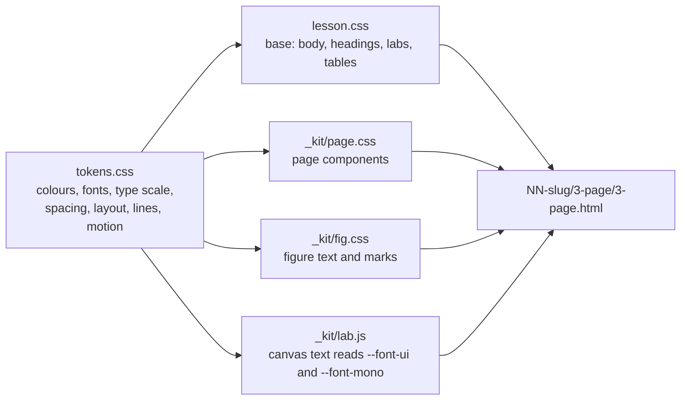

# Design tokens

Every visual decision in the series lives in one file, `tokens.css` at the series root. Nothing else in the series hard-codes a colour, font, size or spacing value. To change the look of every lesson, edit `tokens.css` and rebuild.

## Groups

| Group | Tokens | Change it to |
|---|---|---|
| Colour | `--paper`, `--paper-2`, `--ink`, `--ink-soft`, `--rule`, `--accent`, `--accent-ink`, `--accent-soft`, `--input`, `--input-soft`, `--ok`, `--ok-soft`, `--selection` | restyle the palette. Roles: `--input` (blue) is what the reader controls, `--accent` (amber) is the result to notice and any wrong value, `--ok` (green) is a solved state only; the dark theme repeats the colour tokens at the bottom of the file |
| Code | `--code-bg`, `--code-text`, `--code-keyword`, `--code-string`, `--code-number`, `--code-function`, `--code-call`, `--code-builtin`, `--code-comment` (each 4.5:1 or better on `--code-bg` in both themes) | recolour syntax highlighting; `_kit/highlight.py` tags Python with the standard library tokenizer and pseudocode by keyword |
| Fonts | `--font-body` (Literata), `--font-title` and `--font-ui` (Rubik), `--font-mono` (IBM Plex Mono), `--font-math`; the Google Fonts `@import` on the first line | swap a family: change the import and the token together |
| Weights | `--weight-regular`, `--weight-medium`, `--weight-bold`, `--weight-title` | |
| Type scale | `--text-*` for every role (body, lead, h1, h2, h3, caption, ui, small, micro, table, code, math, figure text) | resize one role everywhere |
| Rhythm | `--leading-*`, `--tracking-*` | |
| Spacing | `--space-1` to `--space-20` on a 4 px base, and semantic spacing: `--space-block` (between blocks), `--space-section` (between sections), `--space-heading-after`, `--space-header-*`, `--space-lab`, `--space-cell-*`, `--space-gutter` | tighten or loosen the page by editing the semantic tokens, not the scale |
| Layout | `--layout-measure` (reading column, 35em, about 70 characters), `--layout-breakout` (figures and labs, 780 px) | change the column or the breakout width |
| Lines and corners | `--line-hair`, `--line-strong`, `--line-mark`, `--focus-ring`, `--radius-sm`, `--radius` | |
| Motion | `--motion-step` (one figure animation step) | |

## Phone

CSS cannot use a custom property inside a media query, so the phone breakpoint (520 px) is the one place a number repeats. Inside it, `tokens.css` only reassigns tokens (`--text-body`, `--text-table`, `--space-lab` and others); no rule changes there.

## Compatibility names

`--measure`, `--column`, `--block-gap` and `--section-gap` are aliases kept for lesson code written before the token file. New code uses the `--layout-*` and `--space-*` names.

## How it reaches a page

`_kit/page.py` copies `tokens.css` and `lesson.css` beside each built page, and the lesson shell links both. `_kit/build-figures.mjs` inlines both into each standalone figure file. `_kit/index.py` links both from the course index.
